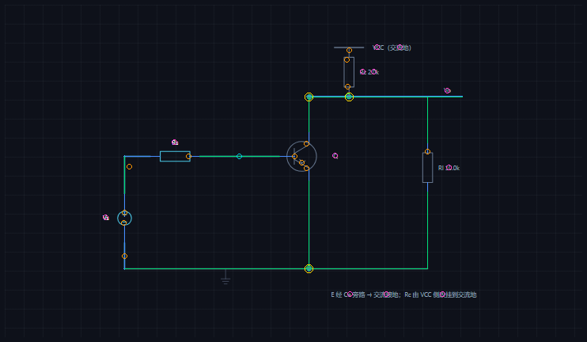

# CV-1 基线：纯 CV 认不认得出我们自己画的电路图

> R3-2.5 第一批。只做测量，不做产品：没给 app 加一行代码，没动 `package.json`、门禁、`src/**`。
> 工具：`scripts/shoot-cv.mjs`（补拍 + 坐标变换）、`scripts/cv-eval.py`（评估）、`docs/cv-baseline.json`（逐条明细）。

## 0. 结论先说

**不达标，CV 只能做辅助。**

| 指标 | §4 门槛 | 实测（口径 B，12 张图合计） | |
|---|---|---|---|
| 线段 recall | ≥95% | **90.5%**（86/95） | ✗ |
| 线段 precision | ≥90% | **68.3%**（86/126） | ✗ |
| 结点 recall | ≥90% | **100%**（33/33） | ✓ |
| 16 型端到端同解 | ≤1e-12 | **未测**（基线没有符号阶段，构不出 Graph） | — |

「结点 recall 100%」不能当能力读：基线在 12 张图上撒了 **304** 个候选，33 个真结点当然全被覆盖；
同一栏的 precision 是 **10.9%**。真正要解决的是「怎么把结点和粗笔画分开」，而这一栏的数字说明现在完全没分开。

主路径按 §4 退回：**规则解析（文字）+ AI 识图（默认关）**，纯 CV 只做「半透明草稿 + 人工确认」。
翻盘需要什么、要几天，写在 §8。

## 1. 评估集：12 张图，真值来自快照本身

图是我们自己渲染的，坐标全在 `src/examples/<id>.json` 的 `render_specs[*]` 里，所以真值不用人标：

| 真值 | 怎么来 | 12 张图合计 |
|---|---|---|
| 线段 | `render_specs[].edges[].points`（缺则按 from/to 折线还原），只取轴对齐段 | 95 条（口径 B） |
| 结点 | `nodes[].kind === 'dot'` | 33 个 |
| 符号 | `kind ∈ {res, vsrc, npn, nmos, opamp, ctrlsrc, diode, gnd}`，中心就是节点 (x, y) | 70 个 |

**补拍 8 张**（§1.1）：`A1 / A2 / A3 / A3-pi / A5 / A5-pi / A6 / A7`；
**重拍 4 张**已有的组态变体：`A3-CB / A3-CC / A5-CG / A5-CD`（同一裁剪框 742×432，但这次每张都带坐标变换）。
只评电路族 —— 力学/数字的图形态不同，等电路跑通再说。

### 1.1 坐标变换不自己推

真值在 user unit，图在像素。两者之间的映射取 **`getScreenCTM()`**（拍图时一并存进 `<name>.meta.json`），
不拿 viewBox 与 rect 手推：`preserveAspectRatio="xMidYMid meet"` 的留白、容器高度都含在 CTM 里，推错一次整张表就是假的。
逐图验证过：A3 的绿色真值线压在灰色导线上、黄圈套在实心结点上（`docs/shots/cv-annot-A3.png`）。

### 1.2 拍图时踩到的一个真坑（已修）

第一版 `#/t/A3` 的 pi 图里有一条**横贯全宽的 4px 亮带**，被基线当成一条长导线（741px，直接毁掉 precision）。
查下来不是图纸：是页面底部那条 `position: sticky` 的播放条（里面有个 `h-1` 的 range），
`captureBeyondViewport` 会把 sticky 元素按**视口位置**画在长截图的中部。
修法：视口加到 1300 高 + `captureBeyondViewport: false` + 裁剪框不出视口断言。
现在 12 张图里**没有任何整行/整列墨迹**（按覆盖率 >90% 扫过一遍）。

## 2. 两个「长线段」口径（先把话说清）

§2 写的是「长度 ≥120px 的轴对齐段」。这个阈值直接用会退化，所以两个口径都报：

- **口径 A（§2 字面）**：≥120 **图像像素**。本仓库的图是 viewBox 754 单位缩到 535px 渲染的（scale≈0.71），
  照字面取 120px，12 张图只剩 **20** 条真值线，A2 **一条都没有** —— 指标变成几十个样本里数一数。
- **口径 B（主表）**：≥60 **图元单位**（≈42 图像像素 @scale 0.71）。

口径 B 不是我挑的，是**反解**出来的：`docs/R3总计划.md` §R3-2.5 那张基线表写着 A3-CB「长水平 5 / 长竖直 4 / 结点 3」，
只有 T=60u 能同时给出这三个数。脚本里有一条**自校准断言**钉住它：

```
自校准（A3-CB）：长水平 5 / 长竖直 4 / 结点 3 —— 与 §0 基线表一致
```

口径一旦被改，这行立刻变红并拒绝出表。

## 3. 主表（口径 B）

识别这一侧只复现 §0 描述的那套原型，不多做：
**墨迹掩膜（与背景通道差 >40）→ 行/列扫长游程 → 共线游程合并 → 局部密度找结点**。
没有符号阶段、没有跨器件补线、没有文字扣除。

| 图 | 线段真值 | 检出 | 线段 recall | 线段 precision | 结点真值 | 检出 | 结点 recall | 结点 precision | 符号 acc | 端到端同解 |
|---|---|---|---|---|---|---|---|---|---|---|
| A1 | 5 | 7 | 100% | 71% | 1 | 6 | 100% | 17% | 未测 | 未测 |
| A2 | 4 | 6 | 100% | 67% | 1 | 20 | 100% | 5% | 未测 | 未测 |
| A3 | 9 | 10 | 89% | 80% | 3 | 29 | 100% | 10% | 未测 | 未测 |
| A3-pi | 12 | 14 | 83% | 71% | 5 | 29 | 100% | 17% | 未测 | 未测 |
| A5 | 8 | 11 | 88% | 64% | 3 | 23 | 100% | 13% | 未测 | 未测 |
| A5-pi | 11 | 12 | 82% | 75% | 5 | 29 | 100% | 17% | 未测 | 未测 |
| A6 | 8 | 12 | 100% | 67% | 3 | 22 | 100% | 14% | 未测 | 未测 |
| A7 | 10 | 16 | 90% | 56% | 3 | 30 | 100% | 10% | 未测 | 未测 |
| A3-CB | 9 | 12 | 89% | 67% | 3 | 30 | 100% | 10% | 未测 | 未测 |
| A3-CC | 5 | 7 | 100% | 71% | 2 | 27 | 100% | 7% | 未测 | 未测 |
| A5-CG | 9 | 11 | 89% | 73% | 3 | 30 | 100% | 10% | 未测 | 未测 |
| A5-CD | 5 | 8 | 100% | 62% | 1 | 29 | 100% | 3% | 未测 | 未测 |
| **合计** | **95** | **126** | **90.5%** | **68.3%** | **33** | **304** | **100%** | **10.9%** | — | — |

命中判据（§2）：同朝向、位置差 ≤4px、重叠 ≥80% 真值长度；精确率 = 一对一匹配上的检出 / 全部检出。
另外单列一个诊断：**命中的线段平均比真值长 1.24×（最大 2.61×，A7）** —— 因为符号自带的引脚短线与导线同宽同色，
游程一过就把线「拉长」到符号体内。这条不影响 recall 判定，但它是「图能认出来、结构还是错的」的直接原因。

## 4. 口径 A 附列（§2 字面）

| 图 | 线段真值 | 检出 | 线段 recall | 线段 precision | 结点 recall | 结点 precision |
|---|---|---|---|---|---|---|
| A1 | 4 | 4 | 100% | 100% | 100% | 17% |
| A2 | 0 | 0 | — | — | 100% | 5% |
| A3 | 2 | 4 | 100% | 50% | 100% | 10% |
| A3-pi | 2 | 4 | 100% | 50% | 100% | 17% |
| A5 | 2 | 4 | 100% | 50% | 100% | 13% |
| A5-pi | 2 | 5 | 100% | 40% | 100% | 17% |
| A6 | 2 | 3 | 100% | 67% | 100% | 14% |
| A7 | 2 | 3 | 100% | 67% | 100% | 10% |
| A3-CB | 1 | 4 | 100% | 25% | 100% | 10% |
| A3-CC | 1 | 2 | 100% | 50% | 100% | 7% |
| A5-CG | 1 | 3 | 100% | 33% | 100% | 10% |
| A5-CD | 1 | 2 | 100% | 50% | 100% | 3% |
| **合计** | **20** | **38** | **100%** | **53%** | **100%** | **10.9%** |

这张表的 100% recall 是**样本退化**给的，不是能力：20 条线全是「最长、最直、最没人挡」的那几条，
A2 一条都没有。它唯一的信息是：**最难的那批（80–120px 的短线）根本不在这张表里**。

## 5. 对照组：同机 2× 像素密度 —— 分辨率不是瓶颈

同一批图，同机 DPR=2 再拍一遍（CSS 布局不变、只是像素更密），同一套参数：

| 口径 B | recall | precision | 结点 recall | 结点 precision |
|---|---|---|---|---|
| DPR 1（主表） | 90.5% | 68.3% | 100% | 10.9% |
| DPR 2 | 90.5% | 37.9% | 100% | 14.9% |

**结论：给两倍像素不解决问题。** recall 原地不动，precision 反而掉——线更厚、字更粗，
与导线粘连的段更多。所以问题不在「看不清」，在「没有线段/符号/文字的区分模型」。
这条很重要：它排掉了「先上采样再说」这条最省事的幻想。

（§1 里另外 6 张扰动对照组没做：缩放/加噪/二值化可以做，但旋转 3° 之后真值不再轴对齐，
需要另写一套匹配器——那就等于换指标定义，按 §5 不做，留到 CV-2 用独立样本。）

## 6. 改法实验：跨断口合并反而更差

§0 猜的第一个病是「线被器件本体打断后没合并」。我在基线后加了一步：
同轴共线 + 断口 ≤120 图元单位 + 断口内确实有墨迹（被判为「被符号挡住」）→ 并成一条。

| 口径 B | recall | precision |
|---|---|---|
| 基线 | **90.5%** | 68.3% |
| 基线 + 跨断口合并 | **77.9%** | 74.0% |

**补线把 recall 打掉 12.6 个点，precision 只换来 5.8 个点。** 原因很具体：本仓库里「两条共线、首尾相接的**独立**导线」
（例如 A3-CB 的 `e-cbus 560→700` 与 `e-out 700→762`）在像素上本来就是一条，
补线再把它们和「真的该断开的地方」一起并掉，一次吃掉两条真值。
所以 CV-2 里「跨器件补线」必须**限制在符号包围盒内**，不能用一个自由间距阈值。

## 7. 病灶清单（每条都指明是哪一类笔画）

全部 12 张图合计。线段漏 9、线段误报 40、结点误报 271。

| 病灶 | 漏检线段 | 误报线段 | 误报结点 | 是哪类笔画 | 下一批怎么改 |
|---|---|---|---|---|---|
| 共线相邻段无法分开 | **7** | **23** | 0 | 导线本体（两条独立边在像素上连成一条） | **线段图元化：在结点/交汇处断开**（最优先） |
| 符号内部笔画 | 0 | **15** | **117** | 电阻方框四边、晶体管圆、电源圆、箭头、受控源菱形 | 符号模板匹配 + 先按符号包围盒扣掉 |
| 文字笔画 | 0 | 2 | **145** | `Rc 2.0k` / `VCC（交流地）` / 底部注释整行 | 先扣已知文字框（本次已存 `textBoxes`，可直接用） |
| 虚线控制标注 | **2** | 0 | 0 | `strokeDasharray: 5 4` 的 vbe 标注 | 5px 的 dash 打散 42px 的游程；要么按虚线专门扫，要么在真值里排除 |
| 线体加粗 / 交汇 | 0 | 0 | **9** | 2.2px 宽的汇流条、T 形交汇处 | 结点判据里加「实心圆面积」，不要只看密度 |
| **合计** | **9** | **40** | **271** | | |



图例：**绿线**=真值线段（虚线真值画成绿色点线）、**蓝线**=检出线段、**黄圈**=真值结点、
**绿小圈**=命中的检出结点、**品红小圈**=文字笔画误报、**橙小圈**=符号内部误报、**青小圈**=线体/交汇误报。
（同款图：`docs/shots/cv-annot-A7.png`，A7 是误差最大的一张，拉长 1.33× / 最大 2.61×。）

三条注释：

1. **线段误差只来自四类，且都不是「扫不出线」**：共线粘连（漏 7 / 误 23）、符号内部笔画（误 15）、文字行（误 2）、虚线（漏 2）。没有一条是「这条线在图上根本看不见」。换句话说：线段这一侧不是「看不清」，是「没有结点概念 + 没有符号概念」。
2. **结点误报 271 里 145 是文字**（53%）。基线把 9×9 窗口里密度 >0.30 的地方都当结点，
   而 14px 高的汉字几乎每个笔画交叉都能过这个阈值。这就是文档说的「18 个候选、15 个误报」的放大版。
3. 上一节已经证明「补线」这条路走不通；这一节说明真正的顺序是：**先有结点/符号/文字，才谈得上线段**。

### 7.1 结点双条件的上限（把「≥3 线交汇」这条先证伪）

§4/CV-2 都提到「实心圆面积 + ≥3 条线段交汇」。我在 304 个候选上把两个特征都量了：

| 特征 | 真结点（中位/最小） | 误报（中位/最大） |
|---|---|---|
| 实心圆面积（半径 5.9×scale px 内墨迹像素） | 45 / 38 | 29 / 79 |
| 穿过该点的线段数 | **2 / 1** | 0 / 2 |

**「≥3 条线段交汇」在本仓库直接给 0 recall** —— 因为一条导线穿过结点时是**一整条**连续游程，
T 形交汇只算 2 条，直线上的结点只算 1 条。想用交汇数判定，前提是线段已经在结点处断开（回到病灶第 1 条）。

面积这条是有效的。扫描结果：

| 双条件（面积≥ / 线≥） | 结点 recall | 结点 precision |
|---|---|---|
| 面积≥28 / 线≥2 | 70% | **96%** |
| 面积≥20 / 线≥2 | 70% | 88% |
| **上限（recall≥90% 下最高 precision）** | 100% | **77%** |

**上限 77% < 90% 门槛。** 阈值是从这 12 张图上反推的，所以这是乐观上限；真实泛化只会更低。
结论：双条件能把 precision 从 11% 抬到 ~77%，但要过 90%，仍然必须先做「线段在结点处断开 + 文字扣除」。

## 8. 判定与建议

按 §4：**不达标 → CV 只能做辅助。** 主路径退回「规则解析（文字）+ AI 识图（默认关）」，
纯 CV 的定位是「半透明草稿 + 人工点确认」。

如果要把结论翻成「可以进 CV-2」，最小改动集是下面四步，顺序不能换（后一步依赖前一步）：

| 步骤 | 做什么 | 现在的数 | 预期 | 工作量 |
|---|---|---|---|---|
| 1 | 线段图元化：骨架化 + 在结点/交汇处断开 + 端点剪到符号包围盒 | recall 90.5% / precision 68.3% / 拉长 1.24× | 病灶第 1 行（7+23）基本清掉 → recall ~97% / precision ~85% | 1.5–2 天 |
| 2 | 文字先扣（用已存的 `textBoxes`，或按字号/位置找） | 145 个结点误报 | 结点 precision 从 11% → ~50% | 0.5 天 |
| 3 | 符号模板匹配（70 个符号，`public/symbols/electronics/*.svg` 栅格化成多尺度模板） | 符号 acc 未测 | 能出 kind；顺带清掉 15 个线段误报 + 117 个结点误报 | 1–1.5 天 |
| 4 | 结点双条件（面积 + 断开后的交汇数） | 上限 77% | 目标 ≥90% | 0.5 天 |

合计 **3.5–4.5 天**，且**第 1 步不成立的话后面三步都是白做**（这也是 §0 那句「病灶不解决，写多少代码都是白写」的量化版）。
我的判断：recall 95% 有把握；precision 90% 要第 1+2+3 步都落地，第 4 步是最后的保险。
风险点是第 3 步的模板匹配——`nmos-r90` 这种横置画法、`sum/block` 这种非器件图元，模板集要比现有 SVG 多一层旋转匹配。

## 9. 这一批没做 / 和任务书不一样的地方

1. **只评了 12 张**，不是「47+ 张」。§1 说只评电路族，`docs/shots` 里电路族就是这 12 张（8 补拍 + 4 重拍）。
2. **口径 A/B 都报**。§2 字面的 120px 会让 A2 的真值归零、全表只剩 20 条线，所以主表用能复现 §0 的 60u（有自校准断言），字面口径单独一张表。
3. **符号 acc 与端到端同解都是「未测」**，不是 0。基线没有符号阶段，硬写 0 会误导成「试过但全错」。
4. **6 张扰动对照组没做**（见 §5 末），理由是旋转后真值不轴对齐，等于换指标。
5. **重拍了 4 张已有截图**（A3-CB / A3-CC / A5-CG / A5-CD）：内容一样、裁剪框一样，但这次额外落了 `.meta.json` 坐标变换，否则这 4 张没法进同一张表。
6. **没有为凑数放宽判据**：精确率用一对一匹配 + 80% 重叠，跨断口并成一条的检出会被扣成误报（这正是 §6 那张表能看出来的原因）。

## 10. 复现

```bash
# 需要带 Pillow + numpy 的解释器（WorkBuddy 自带的 python 没有 PIL）
PY="C:/Users/17897/AppData/Local/Programs/Python/Python312/python.exe"

node scripts/shoot-cv.mjs          # 补拍 12 张 + 12 张 2×，落 meta
$PY scripts/cv-eval.py             # 全部表（主表 / 口径A / 2× / 改法 / 病灶 / 判定）
$PY scripts/cv-eval.py --json docs/cv-baseline.json
$PY scripts/cv-eval.py --annotate A3,A7   # 病灶标注图 → docs/shots/cv-annot-*.png
```
